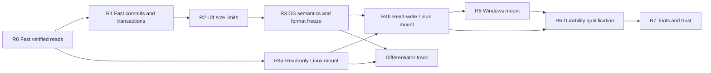

# Roadmap to a mountable filesystem (R0–R7)

**Status:** plan, not a contract. Nothing here is implemented. Milestone specs, source code and tests remain the authority.
**Baseline:** `main` at `98934ac` (after [PR #35](https://github.com/HiroSakuraba/bfs-ng/pull/35)). Open [PR #34](https://github.com/HiroSakuraba/bfs-ng/pull/34) is treated as in progress.
**Companion documents:** [F5 data layer](F5_DATA_LAYER.md) (format design), [F5 progress review](REVIEW_F5_PROGRESS_2026-11-05.md) (measurements), [ARCHITECTURE.md](ARCHITECTURE.md) §7 (backlog).

Each phase below states its goal, why it comes at that point, the work, and an **exit gate** that can be checked by a test or a measurement. Choices are explained in place and collected in the [decision log](#9-decision-log).

---

## 1. Where the project stands

BFS-NG today is a crash-safe storage **library**. Nothing on a computer can use it as a drive: there is no mount, so file managers, shells, editors and `git` cannot see it.

| Stage | Meaning | Status at `98934ac` |
| --- | --- | --- |
| 1. Storage engine | Atomic commits, checksums, snapshots, safe reuse of freed space | **Mostly there.** Correct and heavily tested, but too slow and too small for real use |
| 2. Mountable | Appears as a folder or drive; ordinary programs read and write it | Not started |
| 3. Filesystem semantics | Permissions, times, links, `fsync`; passes standard test suites | Not started |
| 4. Daily-usable | Fast enough for `git clone`, builds and large files | Blocked by full audits (below) |
| 5. Trustworthy | Repair tools, real power-cut testing, long use without loss | Not started |

Three facts set the order of this roadmap:

1. **Every v10 call, read or write, starts with a full audit of both F0 root graphs.** `UnifiedV10::commit`, `stat`, `list_dir`, `read_at`, `snapshots`, `file_attributes` and `search_attributes` all call `audit()`. A mounted filesystem issues many lookups and stats per second, so this alone rules out mounting. The [review](REVIEW_F5_PROGRESS_2026-11-05.md#4-measurements) measured about 2,600 block reads for a one-byte write at 300 files.
2. **Hard caps:** 256 KiB per file (a single-level 64-block extent map), 2,048 namespace entries, 240-byte paths, and a fixed 64-block metadata arena.
3. **No operating-system semantics yet:** the v10 namespace record holds an inode number, a directory flag and an extent root. It has no permissions, owner, timestamps, link count or symlink target.

## 2. What "legitimate" means here

The roadmap targets three tiers, in order.

| Tier | Definition | Reached at |
| --- | --- | --- |
| **T1 — Mountable research filesystem** | Mounts on Linux; ordinary tools work on it; passes a defined xfstests/pjdfstest subset; safe on disposable data | End of R4 |
| **T2 — Daily-usable personal filesystem** | Also mounts on Windows; acceptable speed on real workloads (large files, source trees, asset folders); survives replayed and real power cuts | End of R6 |
| **T3 — Trustworthy** | Frozen on-disk format with `mkfs`/`fsck`/scrub/repair; months of dogfooding on real projects without loss | End of R7 |

**Positioning.** BFS-NG should not try to beat ext4, XFS or btrfs on raw speed. Its credible niche is a **verifiable filesystem with queryable typed metadata and browsable snapshots**: the BeFS idea with modern crash safety. The [differentiator track](#5-differentiator-track-parallel-from-r4) keeps that in view from the first mount.

## 3. Principles carried through every phase

1. **Fail closed, keep the oracle.** Every fast path keeps an independent full-scan oracle in tests. A fast path is enabled only when it agrees with the oracle under fault injection. (ARCHITECTURE §1.4)
2. **Reading never authorizes reuse.** Fast verified reads are fine; physical block reuse still requires certification of both F0 candidates.
3. **One writer, many readers.** Copy-on-write lets readers work from the last published generation while a single writer stages the next one. This is simpler and safer than fine-grained locking.
4. **Measure, don't assume.** Each performance gate is a number from a reproducible harness (extending `crates/storage/examples/v10_commit_io.rs`), not a claim. (ARCHITECTURE §1.6)
5. **Freeze before you mount read-write.** Once real files live on images, format breaks become migrations. The format freezes at the end of R3.
6. **Adapters stay outside the core.** OS mount code lives in separate crates, so the core stays portable, testable without a kernel, and MIT-licensed.

---

## 4. Phases

### R0 — Fast verified reads

**Goal:** reads cost O(tree height), not O(volume).

**Why first:** nothing can be mounted while `stat` walks the whole volume, and fixing reads is lower risk than fixing commits, because reads never authorize reuse.

**Work**

- At open: verify both F0 candidates, their manifests and each tree root (F5 §6.6, lazy open). The full two-root audit runs **once per writable open**, not per call.
- Add a read-only handle (`UnifiedV10::open_read_only`) that never audits beyond open-time checks. Every page and data block it touches is verified through its parent block pointer and the checksum tree, as today.
- Add a pinned read view per published generation, so lookups during a commit see a consistent tree.
- Report corruption found on read as an error for that file or directory. Do not silently fall back to an older root (F5 §6.6 semantic change; update tests to assert it).
- Extend `v10_commit_io` with `stat`, `read_at` and `list_dir` modes.

**Exit gate**

- `stat`, a 4 KiB `read_at` and `list_dir` of a 100-entry directory each read **at most 3× the tree height plus the data blocks** at 10, 300 and 2,000 files. (2,000 stays inside today's 2,048-entry namespace cap; R2 repeats this gate at 100,000 files once the cap is gone.)
- Open on a writable handle still performs exactly one full audit (asserted by a counter). A read-only open performs none.
- Single-byte corruption, lost-write and misdirected-write cases from F5.0b are still detected on read.

**Size:** S–M.

### R1 — Fast commits and real transactions

**Goal:** a small change costs a small number of block reads, and many edits can share one commit.

**Why now:** this is the other half of the review's main finding. It also produces the transaction API that a mount's write path needs.

**Work**

- Finish PR #34's in-handle allocation certificate and extend it from `CrashDevice` to `FileDevice` opened under an **OS-level exclusive lock** (`flock` on Linux, `LockFileEx` on Windows, for example through the `fs4` crate). Reasoning: one process and one handle is the same single-writer situation PR #34 already proves for the test device. The lock makes it true for real files.
- Rebuild the certificate with a full audit on every open, after any failed publication, and on every poisoned handle. Never carry it across recovery.
- Add a v10 transaction type (as v9's `FsTransaction` has): many `mkdir` / `write_at` / `truncate` / `rename` / `unlink` / attribute edits, then one publication.
- Keep the full two-root audit available as a `Full` verification mode and as the per-commit oracle in tests.

**Exit gate**

- With the certificate on a locked `FileDevice`: block reads per one-byte overwrite at 2,000 files are **within 2× of the value at 10 files** (inside the current 2,048-entry cap; R2 repeats the gate at 100,000 files). `v10_commit_io` becomes a CI check for this.
- PR #34's cached-versus-full differential workload passes on `FileDevice`.
- A second process trying to open the same image for writing fails cleanly.
- A transaction of N edits publishes exactly one generation; crash injection at every write and sync shows all-or-nothing.

**Size:** M.

### R2 — Lift the size limits

**Goal:** real files and real trees.

**Why now:** a mount that cannot hold a 300 KiB file is not useful, and these structures change the on-disk format, which must settle before the R3 freeze.

**Work**

- **Multilevel per-file extent tree** (F5 §7) replacing the single 64-block leaf, with extents of up to 32 MiB.
- **Streaming writes with spill** (F5 §7.4): bounded transaction memory regardless of file size.
- **Inline small files** at or below 2,048 bytes (F5 §7.3).
- **Localized namespace updates:** path-copy only the changed leaves (as v9's F3 already does), instead of rebuilding the whole namespace tree.
- **`(parent inode, name)` directory entries and an inode table** (F5 §10): O(height) rename, short keys, room for hard links.
- **Size the metadata arena from geometry**, with the worst-case bound PR #19 requires, instead of a fixed 64 blocks.
- Remove the 2,048-record cap. Names up to 255 bytes.

**Exit gate**

- Write and read back a **1 GiB** file with random 4 KiB overwrites, matching a sparse-file reference model across injected crashes; transaction memory stays under a fixed budget.
- **100,000 files** in one directory tree; the R0 read gate and the R1 commit gate are re-run at this size and still hold (compared with their 10-file values).
- Renaming a directory with 10,000 descendants writes O(height) pages.
- Fragmentation test (F5 §15): fill with small files, delete every other one, then write a file larger than any free run. It must succeed.

**Size:** L. This is the critical path of the whole roadmap.

### R3 — Operating-system semantics and format freeze

**Goal:** the engine can answer everything a kernel will ask.

**Why now:** these fields are on-disk format, so they go in before the freeze, and the FUSE and WinFsp adapters are thin only if the core already has these semantics.

**Work**

| Feature | Notes |
| --- | --- |
| Inode attributes | Mode, uid, gid, link count, size, mtime, ctime, birth time; atime policy below |
| Hard links | Several directory entries pointing at one inode, with a link count |
| Symlinks | Target stored inline in the inode |
| Unlink while open | An on-disk orphan list, so a file deleted while still open survives until last close and is cleaned up after a crash |
| Rename | Atomic replace of an existing target, plus "no replace" and "exchange" variants |
| Directory listing | Stable cursors that survive concurrent changes (use the name key as the cursor) |
| `fsync` / `fdatasync` | "Return once a generation containing this change is durably published" |
| Sparse files | Hole and data seeking (`SEEK_HOLE` / `SEEK_DATA`) from the extent map |
| Extended attributes | Map F4 typed attributes onto xattrs in a dedicated namespace (for example `user.bfs.<name>`); allow plain untyped xattrs too |
| `statfs` | Real free-space and inode counts, net of the metadata reserve |
| Disk full | Correct "no space" errors; deletes still succeed on a full volume (F5 §8.5 reserve) |

**atime policy:** default to not updating access times, with an option for relatime-style behavior. Reasoning: on a copy-on-write filesystem every atime update is a metadata write and a commit, which turns reads into writes.

**Format freeze:** declare the result **BFS-NG on-disk format 1**. From then on, newer code must open format-1 images, and any change needs a version bump plus a tested migration. ARCHITECTURE commitment 7 ("old formats are not silently opened") stays: they are opened deliberately, by versioned code.

**Exit gate**

- A semantic model in Rust (an in-memory reference filesystem) agrees with the engine on randomized operation sequences that cover every row above, including crash points.
- Format-1 golden images are committed to the repo and checked by CI on every later change.

**Size:** M–L.

### R4 — Linux mount (reaches T1)

**Goal:** mount an image on Linux and use it with ordinary tools.

**Work**

- New crate `crates/fuse` (binary `bfs-ng-mount`), built on the **`fuser`** crate, a Rust reimplementation of libfuse that uses libfuse only for mount and unmount. Reasoning for FUSE over a kernel module: a userspace filesystem can be written and debugged in safe Rust and cannot crash the kernel, and it avoids the upstreaming problems that cost bcachefs its place in mainline. Newer kernels (6.14+) can carry FUSE traffic over io_uring, which reduces per-request overhead.
- **R4a — read-only mount first.** It is low risk, because reads are already fully verified, and it delivers the snapshot browser early: `/.snapshots/<generation>/…` as read-only directories.
- **R4b — read-write mount.** One writer thread owns the R1 transaction; FUSE request threads read from the last published generation. **Group commit**: publish every N milliseconds or on `fsync`, whichever comes first.
- Kernel caching: start conservative (short attribute and entry timeouts, no writeback cache) and relax only with measurements.
- Tooling: minimal `mkfs.bfsng` and `bfs-ng-mount <image> <dir>`.

**Exit gate (T1)**

- `cp -a` of a real source tree in and out, `git clone`, `git status` and a `cargo build` of this repository all work on a mounted image, with byte-identical results.
- **xfstests** (run against FUSE filesystems with `./check -fuse`): a documented list of passing `generic/` tests. Every excluded test has a written reason.
- **pjdfstest** (POSIX semantics) and **fsx** (randomized read, write, truncate and mmap against a reference copy) pass for a defined configuration.
- Killing the mount process at random points during fsstress never loses a fsync'd change and never produces an unmountable image.

**Size:** M.

### R5 — Windows mount

**Goal:** the same images mount as a drive on Windows.

**Work**

- New crate `crates/winfsp` using the **`winfsp`** Rust bindings (WinFsp 2.x).
- **Licensing:** the `winfsp` crate is **GPL-3.0**, while BFS-NG is MIT. Keep the Windows adapter as a separate crate and binary so the core and the Linux adapter stay MIT. Treat the Windows mount binary as GPL-3.0 when distributed. Reasoning: this keeps the license question contained to one optional component.
- Map semantics: case sensitivity (default case-sensitive, matching the on-disk names), Windows attributes and timestamps, delete-on-close, and file sharing modes on top of the R3 model.
- Note the binding's own caveats (best-effort soundness, some excluded upstream tests) and run the WinFsp test suite against BFS-NG.

**Exit gate**

- A folder copied in Explorer, a `git clone`, and a build of this repository work on a mounted image.
- The WinFsp test suite passes with a documented exclusion list.
- Images round-trip between Linux and Windows with identical content and attributes.

**Size:** M.

### R6 — Durability qualification (reaches T2)

**Goal:** evidence, not just models, that committed data survives crashes and that bad images cannot hurt the host.

**Work**

- **Write-order recording and replay:** a recording `BlockDevice` logs every write and sync from real mount workloads. A replayer reconstructs every crash state the ordering allows, opens each, and checks it against the reference model. This is the CrashMonkey and dm-log-writes approach, done in-process.
- **Real power cuts:** a cheap test rig (USB or NVMe SSD on a switchable supply) running fsstress with periodic `fsync` markers; verify after each cut. Repeat across at least two device models.
- **Fuzzing:** `cargo-fuzz` targets for every page, manifest and extent decoder, plus structure-aware image fuzzing. Required properties: no panics, bounded memory and time, and corrupt input always fails closed.
- **Performance pass:** real workloads (source trees, DVE asset folders, AxiomZig/MegaDoc corpora, large sequential files) against ext4 or NTFS on the same machine. Report both ratios and absolutes; no hardware claims beyond what was measured. Integrate the C5 metadata cache here if measurements justify it.

**Exit gate (T2)**

- Zero lost fsync'd writes across the replay suite and at least 1,000 real power cuts.
- 24 hours of fuzzing per decoder with no findings open.
- A written performance report with reproducible scripts.

**Size:** M–L.

### R7 — Tools and trust (reaches T3)

**Goal:** someone other than the author could run it and recover from problems.

**Work**

- **`fsck.bfsng`:** offline checker built from the existing independent oracles (two-root reachability, reference reconstruction, posting oracle). These are already most of an `fsck`, which is a real head start.
- **Online scrub:** read and verify everything in the background, with bounded progress persisted across restarts.
- **Repair policy:** decide and document what is repaired automatically (for example, leaked space), what is offered interactively (for example, salvaging readable files from a damaged tree), and what is refused.
- **Image inspection:** a dump tool for roots, trees and extents, for debugging and bug reports.
- **Migration:** a tested path from format 1 to any format 2.
- **Dogfooding:** keep real working copies of the author's own projects on BFS-NG for several months, with backups, logging every anomaly.
- **User documentation:** install, mount, snapshots, attribute queries, recovery.

**Exit gate (T3)**

- Several months of dogfooding with no data loss and no unexplained `fsck` findings.
- `fsck` detects every corruption class in the fault-injection suite.
- A tagged `v0.1` release with the format-1 specification.

**Size:** L, and mostly elapsed time.

---

## 5. Differentiator track (parallel, from R4)

These are the reasons to use BFS-NG instead of an established filesystem. They can proceed alongside R5–R7 once a mount exists.

| Item | Builds on | Gate |
| --- | --- | --- |
| **Snapshot browsing** | R4a | `/.snapshots/<generation>/` lists every pinned snapshot; create and drop snapshots through a CLI |
| **Typed attributes as xattrs** | R3, F4 | `setfattr` / `getfattr` round-trip typed values with schema validation errors surfaced as normal errors |
| **Attribute queries in the mount** | F5.5 incremental postings | A query interface (for example `bfs-ng query '<predicate>'` and a virtual `/.query/` directory) returns matching paths in time proportional to matches, not to volume size |
| **Incremental posting index** | F5.5 | One attribute change rewrites O(height) pages, not the whole section |
| **Live queries** | Above | Change notifications for a saved query, which BeFS was known for |

## 6. Dependencies

R4a (read-only mount) depends only on R0, so a first mount can arrive early, before R1–R3 finish. It is worth doing for motivation and to start finding semantic gaps.

## 7. Summary

| Phase | Outcome | Tier | Relative size |
| --- | --- | --- | --- |
| R0 | Reads cost O(height) | — | S–M |
| R1 | Commits cost O(change); transactions | — | M |
| R2 | Large files, large trees, real namespace | — | **L (critical path)** |
| R3 | OS semantics; **format 1 frozen** | — | M–L |
| R4 | Linux mount; xfstests/pjdfstest/fsx subset | **T1** | M |
| R5 | Windows mount | — | M |
| R6 | Crash replay, power cuts, fuzzing, performance report | **T2** | M–L |
| R7 | fsck, scrub, repair, migration, dogfooding, v0.1 | **T3** | L (mostly elapsed time) |

Sizes are relative effort, not dates. For calibration, at the pace of the F5 work, R0–R4 is a matter of weeks to a few months; passing the standard suites typically surfaces many small semantic bugs; and T3 requires months of real use that cannot be compressed.

## 8. Deliberately deferred

| Item | Why deferred |
| --- | --- |
| On-disk Accounted reuse mode (F5.3) | R1's certificate gives most of the speed with the full audit still at open. Accounted mode stays opt-in research until its oracle is complete |
| Shared extents / reflink (F5.6) | Interacts with every free path; OpenZFS shipped block cloning in 2.2.0, users hit corruption, and 2.2.1 disabled it until 2.2.2 fixed it |
| Compression, encryption | Need their own format fields and threat model; reserved fields exist |
| Multiple devices, redundancy | Out of scope for a single-image personal filesystem |
| Kernel module | FUSE first; revisit only if measurements show FUSE overhead is the bottleneck |
| macOS | `fuser` lists macOS as untested and it needs macFUSE; revisit after T2 |
| Multiple writers | The single-writer, many-reader model fits a personal filesystem and is far easier to prove |

## 9. Decision log

| Decision | Chosen | Rejected | Reasoning |
| --- | --- | --- | --- |
| First milestone | Fast reads (R0) | Fast commits first | Reads block mounting entirely and are lower risk: they never authorize reuse |
| Commit speed | Per-handle certificate under an OS exclusive lock | Accounted on-disk mode | Same single-writer argument PR #34 proves; full audit kept at open and as oracle |
| Concurrency | One writer thread, readers on published generations | Fine-grained locking | Copy-on-write makes snapshot reads free; far simpler to reason about |
| Durability API | Group commit; `fsync` waits for publication | Publish per operation | Per-operation publication costs three syncs each |
| Mount technology | FUSE (Linux), WinFsp (Windows) | Kernel module | Safe Rust, no kernel crashes, no upstreaming dependency |
| First mount | Read-only | Read-write first | Low risk, early snapshot browser, finds semantic gaps sooner |
| Adapter packaging | Separate crates per OS | Adapters in the core crate | Portability, testability without a kernel, and isolating the GPL-3.0 `winfsp` dependency from the MIT core |
| atime | Off by default | Always update | Every atime update is a CoW metadata commit |
| Format stability | Freeze format 1 at the end of R3 | Keep breaking formats | Real files on images make every break a migration |
| Positioning | Verifiable, queryable, snapshot-browsable | Compete on raw speed | Speed is where established filesystems are strongest; typed queries are where BFS-NG is distinct |

## 10. Risks

1. **R2 is large and touches the format.** Mitigation: keep the reference model and oracles running against every intermediate PR; land the extent tree and namespace changes behind the existing experimental module until R3.
2. **Semantic long tail in R3–R4.** xfstests and pjdfstest will find many small mismatches (rename corner cases, link counts, timestamps). Budget for it; track exclusions explicitly.
3. **FUSE caching versus copy-on-write.** Aggressive kernel caching can show stale data after a commit. Start conservative and add invalidation before relaxing timeouts.
4. **Windows semantics** (sharing modes, delete-on-close, case handling) are a different model from POSIX. Keep the mapping in the adapter, not the core.
5. **Power-cut results depend on hardware.** Some devices ignore flush commands. Test at least two models and document which ones lose data.
6. **Scope creep from the differentiator track.** Keep it parallel and gated; it must not delay R0–R4.

## 11. References

- BFS-NG: [ARCHITECTURE.md](ARCHITECTURE.md), [F5 data layer](F5_DATA_LAYER.md), [F5 progress review](REVIEW_F5_PROGRESS_2026-11-05.md), [PR #34](https://github.com/HiroSakuraba/bfs-ng/pull/34)
- `fuser` (Rust FUSE implementation): https://github.com/cberner/fuser
- `winfsp` Rust bindings (GPL-3.0, WinFsp 2.1): https://docs.rs/crate/winfsp/latest
- Running xfstests against a FUSE filesystem (`./check -fuse`), example: https://docs.rs/crate/libfuse-fs/0.1.13/source/tests/run_xfstests.md
- xfstests overview: https://kernel.googlesource.com/pub/scm/fs/ext2/xfstests-bld/+/HEAD/Documentation/what-is-xfstests.md
- FUSE over io_uring (Linux 6.14): https://www.phoronix.com/news/Linux-6.14-FUSE
- bcachefs removal from mainline: https://www.linuxjournal.com/content/bcachefs-ousted-mainline-kernel-move-dkms-and-what-it-means
- OpenZFS block cloning history: https://slicker.me/zfs/block-cloning.html
- ShardStore validation approach (reference models, crash testing): https://muratbuffalo.blogspot.com/2021/10/using-lightweight-formal-methods-to.html
